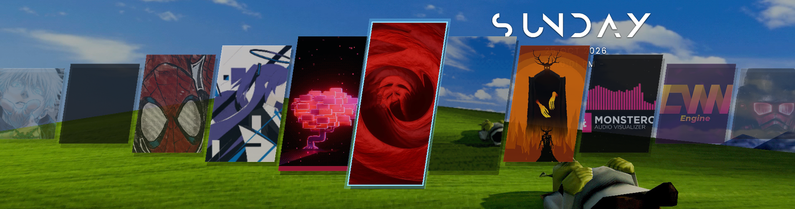
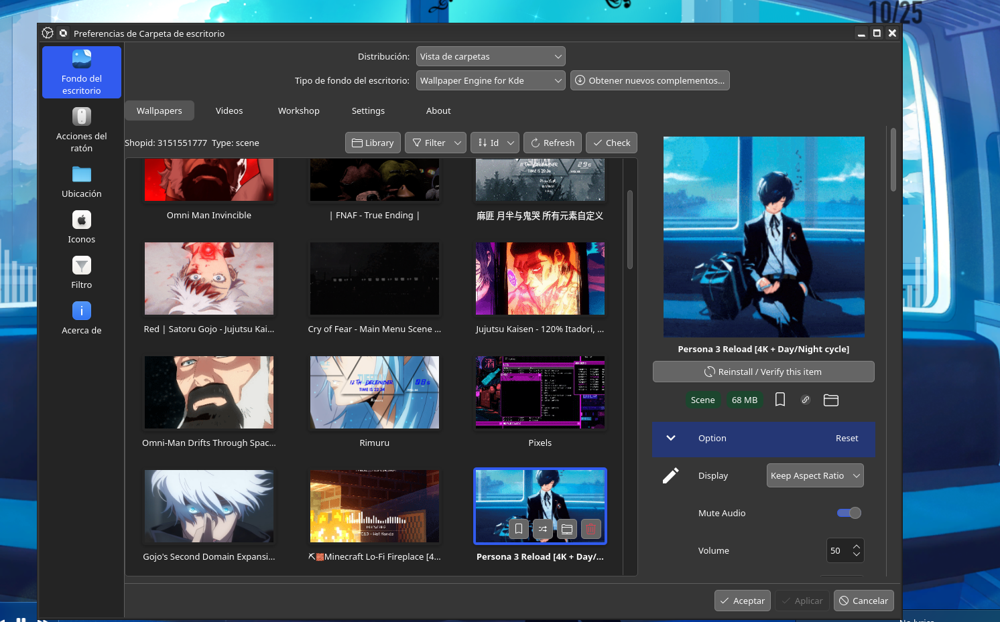
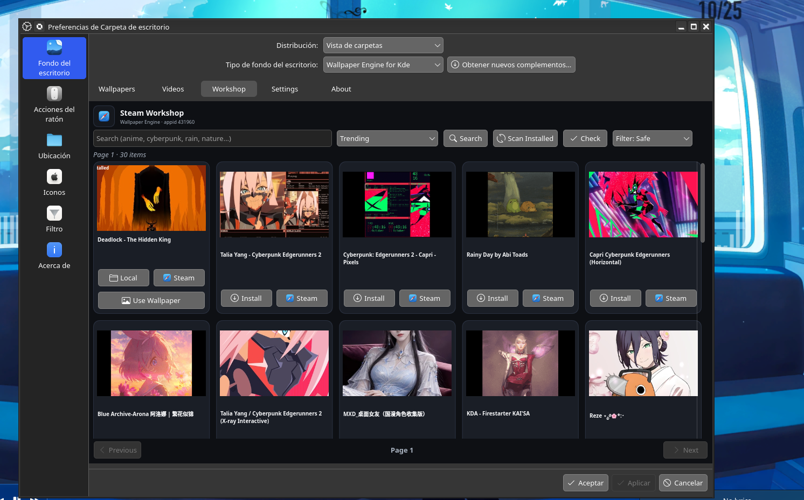
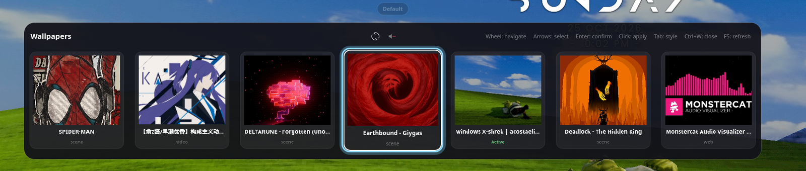
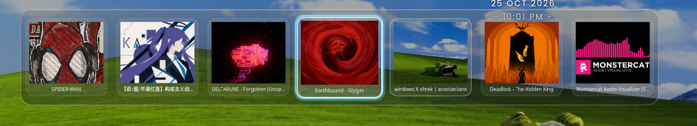
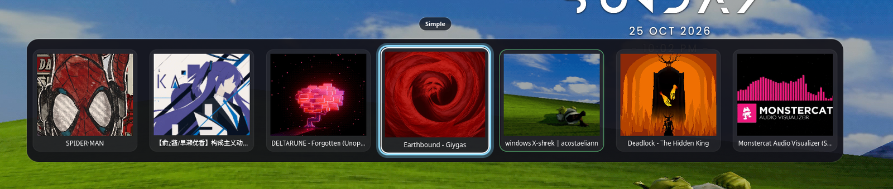
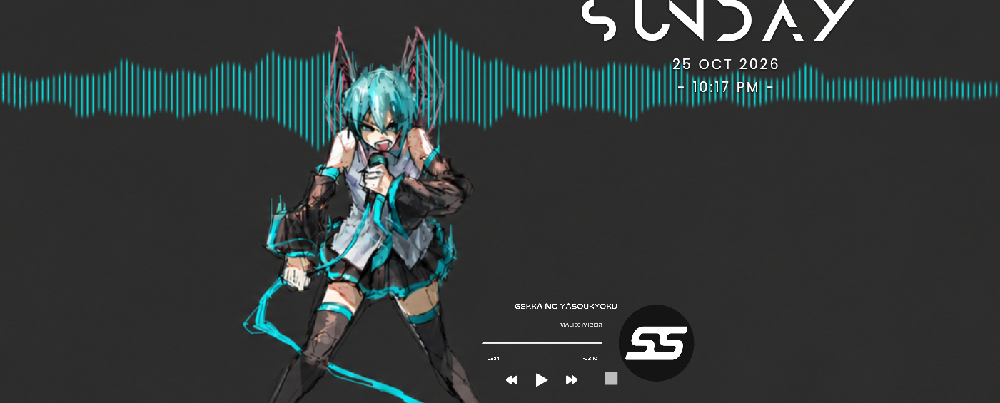
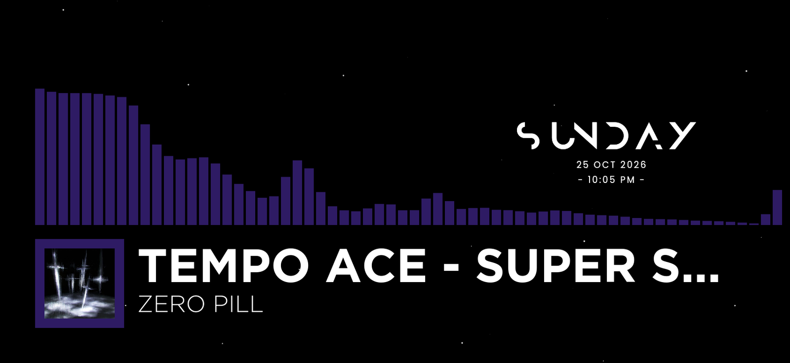
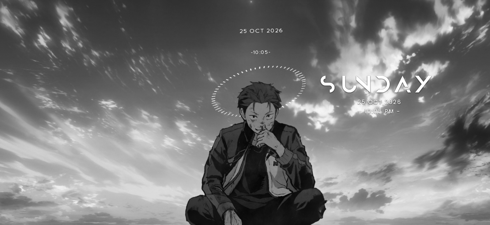

# WEPLUSforKDE

**Wallpaper Engine wallpapers for KDE Plasma 6.**

WEPLUSforKDE is a Plasma 6 wallpaper plugin that loads Wallpaper Engine Scene, Web, Video, and Workshop preset wallpapers from Steam. It is a fork of [catsout/wallpaper-engine-kde-plugin](https://github.com/catsout/wallpaper-engine-kde-plugin) with an updated QML interface, Workshop tools, preset handling, and media integration.



**Version:** 1.0.0  
**Author:** [@vixtrs](https://github.com/vixtrs)  
**License:** GPL-2.0-or-later

## Features

- Scene, Web, Video, and Workshop preset wallpapers.


- Native Vulkan SceneViewer backend (`libWallpaperEngineKde.so`).
- Scene package translation (`PKGV`, `TEXV`/`TEXB`, SceneScript polyfills).
- Steam Workshop browser, downloader, integrity audit, and cleanup.
- Preset and dependency resolution with non-destructive staging.
- PipeWire/PulseAudio FFT bridge for audio-reactive web wallpapers.
- MPRIS2 metadata and album-art integration for Scene wallpapers.
- Desktop selector with Simple, Hyprland, Glass, and Default styles.
- Synchronous pointer forwarding to SceneViewer.

## Screenshots

| Wallpapers | Workshop |
| :---: | :---: |
|  |  |

### Selector styles

| Style | Preview |
| :--- | :--- |
| **Hyprland** |  |
| **Default** |  |
| **Glass** |  |
| **Simple** |  |

### Media integration

| Interactive controls | Audio visualizer |
| :---: | :---: |
|  |  |



## Requirements

See [REQUIREMENTS.md](REQUIREMENTS.md) for the full table and distribution package names.

| Component | Minimum (1080p @ 30 FPS, 1 monitor) | Recommended (1440p/4K @ 55-60 FPS, 1-2 monitors) |
| :--- | :--- | :--- |
| OS / desktop | KDE Plasma 6.0+, Qt 6.6+ | KDE Plasma 6.2+, Qt 6.7+, PipeWire |
| CPU | 4 cores / 4 threads | 6 cores / 12 threads |
| GPU | Vulkan 1.2+, 1 GB VRAM | Vulkan 1.3+, 4 GB VRAM |
| RAM | 8 GB | 16 GB |
| Storage | 2 GB free | 10 GB+ on SSD/NVMe |
| Software | `steam`, `python3`, `mpv`, QtWebEngine, `libWallpaperEngineKde.so` | + `python-pillow`, `python-numpy`, `python-websockets`, `playerctl`, `ffmpeg`, `curl` |

Scene and video wallpapers require the native backend (`libWallpaperEngineKde.so`). On Arch/CachyOS it is usually provided by `wallpaper-engine-kde-plugin-git` from the AUR. On other distributions, build the upstream C++/Vulkan backend.

Python 3.10+ is recommended, with `Pillow`, `numpy`, and `websockets`. The Easy Setup script can install these packages on Arch, Fedora, Debian/Ubuntu, and openSUSE. `kdotool` is optional and used to minimize Steam windows during downloads.

## Easy Setup (recommended)

```bash
chmod +x install.sh
./install.sh
```

The installer detects your distribution, offers to install the Python/multimedia dependencies, backs up an existing installation, installs the plugin, checks for `libWallpaperEngineKde.so`, and restarts Plasma if you want.

Useful flags:

```bash
./install.sh --no-deps      # skip system package installation
./install.sh --yes          # assume yes
./install.sh --no-restart   # do not restart plasmashell
```


## Manual installation

```bash
kpackagetool6 -t Plasma/Wallpaper -i com.github.catsout.wallpaperEngineKde
```

If the plugin is already installed, use `-u` instead of `-i`:

```bash
kpackagetool6 -t Plasma/Wallpaper -u com.github.catsout.wallpaperEngineKde
```

Then restart Plasma:

```bash
systemctl --user restart plasma-plasmashell.service
```

## KDE Store installation (Not available yet)

1. Open **System Settings → Wallpaper → Get New Plugins…**
2. Search for **WEPLUSforKDE**.
3. Install it and restart Plasma if requested.

The KDE Store archive (`WEPLUSforKDE-v1.0.0-kdestore.zip`) is published with the GitHub release. Its `metadata.json` is at the archive root, so it is directly installable.

This fork keeps the upstream plugin id (`com.github.catsout.wallpaperEngineKde`) for drop-in compatibility with existing wallpapers and settings. Remove the original catsout plugin before installing WEPLUSforKDE; both packages cannot be installed side by side.

## Usage

1. Install Wallpaper Engine on Steam and subscribe to Workshop items.
2. Open the wallpaper configuration and select the Steam library that contains `steamapps/workshop/content/431960`.
3. Use **Auto-Detect Library** or **Smart Manual Mode**.
4. Select a wallpaper and apply it. Workshop presets are resolved automatically.
5. Press **Ctrl+W** or middle-click the desktop to open the selector; press **Tab** to cycle styles.

## How it works

- `translate_pkg.py` extracts `PKGV0023/24/18` containers, rewrites `scene.json`, and injects SceneScript polyfills. These include `__wekTick`, the media events (`mediaPropertiesChanged`, `mediaPlaybackChanged`, `mediaTimelineChanged`, `mediaThumbnailChanged`), a `cursorDown` → `cursorClick` bridge with a 250 ms debounce, and a text bridge that writes to `thisLayer.text`. Embedded PNGs are extracted from `TEXV`/`TEXB` containers; generated media and trail textures are written as `TEXV0005`/`TEXB0004`.
- `wek-preset.py` resolves preset dependencies, saves the original base files under `.wek_base_orig/`, stages preset files under `translated/<baseId>/wek-preset-<presetId>/`, and keeps per-preset configuration in `~/.config/wekde/wallpaper/<presetId>.json`.
- `wek-web-bridge.py` captures system audio from PipeWire/PulseAudio, computes a 64-band FFT (48 kHz, 2048-sample window), and serves the values over `ws://127.0.0.1:38765`.
- `Scene.qml` reads MPRIS2 metadata and forwards it to the native backend. Album art is converted with `png2tex.py`, which writes atomically to avoid partial textures.
- `main.qml` forwards pointer events to `SceneViewer.simulateHoverAt()` and `simulateClickAt()`. The configured FPS is capped at 55 (`Math.min(55, ...)`) to avoid known plasmashell issues at 60 FPS on some Wayland setups.
- `wek-download.py` uses `steam -silent +workshop_download_item`, reads `workshop_log.txt`, checks `appworkshop_431960.acf`, and can minimize Steam windows with `kdotool`.

## Troubleshooting

- **Scene wallpaper crashes or renders black:** remove the `WallpaperSource` line from `~/.config/plasma-org.kde.plasma.desktop-appletsrc` and restart Plasma. Try 30 FPS for heavy scenes.
- **Web wallpaper is blank:** verify that QtWebEngine is installed and that the wallpaper does not depend on unsupported WebGL features.
- **Video wallpaper does not play:** install `mpv` or the GStreamer codecs and select the correct video backend.
- **Steam download stays queued:** check `workshop_log.txt`; the plugin also tries `steam -silent +workshop_download_item 431960 <id>`.
- **60 FPS causes problems:** use 30 FPS. The plugin caps at 55 by default.
- **Native backend missing:** install/build `libWallpaperEngineKde.so`; the QML package alone cannot render Scene wallpapers.

## Related projects

- **catsout/wallpaper-engine-kde-plugin** — upstream base for the QML package and native backend. The repository is archived and points to Waywallen.
- **waywallen/waywallen** — separate Rust wallpaper manager with its own plugin system. WEPLUSforKDE does not require it.
- **Almamu/linux-wallpaperengine** — Scene renderer and format/shader references.
- **luisbocanegra/plasma-smart-video-wallpaper-reborn** — video-only Plasma wallpaper plugin; useful reference for media playback and power/screen pause behavior.

## Credits

- **@vixtrs** — WEPLUSforKDE.
- **catsout** — original plugin and native backend.
- **Almamu and contributors** — linux-wallpaperengine.
- **luisbocanegra** — Smart Video Wallpaper Reborn.
- **Qt, KDE Plasma, PipeWire, playerctl** — application and multimedia foundations.

## License

GPL-2.0-or-later. See [LICENSE](LICENSE).

## Disclaimer

WEPLUSforKDE is an independent community fork. It is not affiliated with Wallpaper Engine, Valve, KDE, or the original plugin author. Wallpaper Engine assets are not included; you need to own the game and subscribe to the Workshop items you use.

## Repository layout

- `com.github.catsout.wallpaperEngineKde/` — Plasma wallpaper package.
- `docs/screenshots/` — screenshots used by this README and the KDE Store listing.
- `install.sh`, `uninstall.sh` — Easy Setup scripts.
- `kdestore/DESCRIPTION.md` — text for the KDE Store listing.
- `dist/` — generated release archives (not committed).
- `.github/workflows/release.yml` — builds and publishes the KDE Store and Easy Setup archives on tags.
